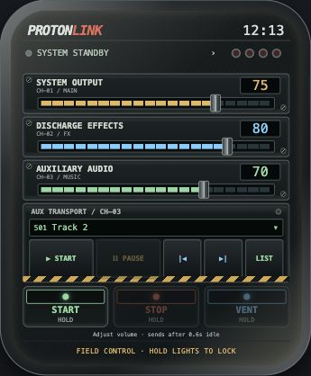

# ProtonLink

[](https://github.com/RStevens-dev/ProtonLink/actions/workflows/pages.yml)

ProtonLink is a wrist-sized controller for GPStar prop electronics. Its **Industrial Control** panel puts pack power, manual vent, three volume faders and music playback on one screen. Today it runs in a browser. A local bridge connects it to a real Wi-Fi Attenuator. Native firmware for the Waveshare ESP32-S3 Touch AMOLED 2.06 is planned.

**Try it without a pack:** [Open the browser simulator](https://rstevens-dev.github.io/ProtonLink/).

## Start with your pack

Download and extract the [current source](https://github.com/RStevens-dev/ProtonLink/archive/refs/heads/main.zip), or use your existing checkout. Connect your computer to the Attenuator’s network. Open a terminal in the ProtonLink folder and run this command with Python 3 installed. Replace the example address if your Attenuator uses a different one.

```sh
python3 scripts/live_bridge.py --host 192.168.1.2 --enable-commands
```

1. Leave the terminal open. Open [the local controller](http://127.0.0.1:8080/simulator/) and choose **Equipment connection → Connect via local bridge**.
2. Hold the watch face for two seconds, release, then swipe left within five seconds.
3. On Gen 1, unlock opens **Industrial Control**. With the default layout, you should see **three volume faders**, **music transport**, and **START / STOP / VENT** along the bottom. Hold a pack switch for one second to request its action.



*Industrial Control in the simulator. The pack’s reported state determines which switches are available.*

To view telemetry only, omit `--enable-commands`. Press **Ctrl+C** in the terminal to stop the bridge. [Live connection guide](docs/LIVE_INTEGRATION.md)

## GPStar version and compatibility

The reference rig is **GPStar I (Gen 1)** with a non-motion Neutrona wand and a Wi-Fi Attenuator. Its captured status reports **Super Hero** mode. The exact pack board revision and the installed firmware releases for the pack, wand and Attenuator are still unknown. The movie year on the display is the selected era. [Reference status capture](tests/fixtures/legacy-gen1-status.json)

| Feature | Gen 1 support |
| --- | --- |
| Field Lock and telemetry | The reference capture includes pack and wand power, firing, cable, lid, temperature, track and three volume levels. The bridge polls status; the browser can also receive WebSocket updates. |
| Pack power and manual vent | START, STOP and VENT are implemented with hold confirmation and state checks. Vent requires the pack to be on. Physical vent confirmation on the reference rig is pending. |
| Audio mixer | System Output adjusts master volume. Discharge Effects adjusts the **sound effects volume**. Auxiliary Audio adjusts music volume. Live faders request steps and check the reported level. |
| Music and library | Start/stop, pause/resume, previous/next and track selection are implemented. The reference rig reports tracks 500–514. Other rigs supply their own range. Playback behavior still needs verification per firmware build. |
| Movie era and stream | Read-only in Pack Info. The owner reports that stream selection and all four year changes are unavailable on the reference rig. |
| Smoke and vibration | Dedicated toggles are unavailable on this rig. Manual Vent is a separate command. |
| Equipment settings | Available pack, wand and smoke preferences can be read. Lighting previews and local presets do not write persistent equipment settings. |
| Native watch and GPStar II motion | Planned or outside current live support. This repository does not provide flashable watch firmware. |

### Supporting a later revision

Record the **pack and wand board revisions**, their firmware releases and the **Attenuator build** separately. Start read-only and capture sanitized status, preferences and advertised API paths. Compare missing fields, units and types with the Gen 1 fixture before enabling controls.

For a changed command, check its HTTP method, route, required pack state and reported outcome. Update the bridge allowlist, command mapping and UI availability together. Live era selection requires confirmed ESP32 pack preferences and an advertised year-specific route. Streams are checked individually; smoke and vibration each require both on and off routes. Add a fixture for the revision, run both profiles through the tests, then verify each new control on hardware before marking it confirmed. [API reference](docs/API.md) · [Bridge](scripts/live_bridge.py) · [Command mapping](simulator/commands.js)

## Contributing

Open a pull request with the change and what you expected it to do. **GitHub Actions automatically runs the simulator, bridge and browser tests on pull requests.** Look for the green check under **Simulator regression tests** in the pull request. A green check covers automated behavior; physical results belong in the change description.

If you tested with equipment, **one sentence is enough**: “Tested on [pack generation and firmware, if known]; [action tried] produced [observed result].” Simulator-only contributions are welcome. [Development workflow](docs/DEVELOPMENT.md) · [Test runs](https://github.com/RStevens-dev/ProtonLink/actions/workflows/pages.yml)

## Project guides

| For | Start here |
| --- | --- |
| Operating the watch | [Industrial Control](docs/QUICK_CONTROL.md) · [Field Lock faces](docs/FIELD_FACES.md) · [Track library](docs/TRACK_LIBRARY.md) |
| Personalizing a rig | [Field setup, presets and favorites](docs/FIELD_SETUP.md) · [Display options](docs/IMMERSION.md) |
| Understanding the equipment | [Equipment audit](docs/EQUIPMENT.md) · [Architecture](docs/ARCHITECTURE.md) · [Communications](docs/COMMUNICATIONS.md) |
| Working on ProtonLink | [Simulator lab](docs/LAB.md) · [Deployment](docs/DEPLOYMENT.md) · [Roadmap](docs/ROADMAP.md) |

ProtonLink is an independent project. GPStar and Ghostbusters names identify compatibility and inspiration. Upstream GPStar firmware is GPL-3.0; ProtonLink does not vendor that firmware. A ProtonLink license has yet to be selected. [Original GPStar source](https://github.com/gpstar81/GPStar-proton-pack) · [Current GPStar source](https://github.com/GPStarTechnologies/GPStar-Core-Source) · [Waveshare board guide](https://www.waveshare.com/wiki/ESP32-S3-Touch-AMOLED-2.06)
